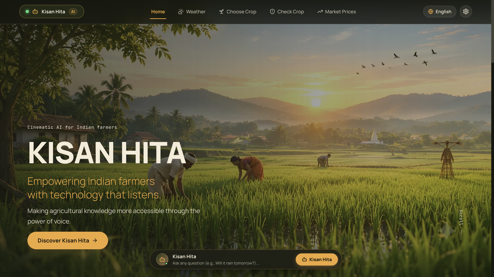
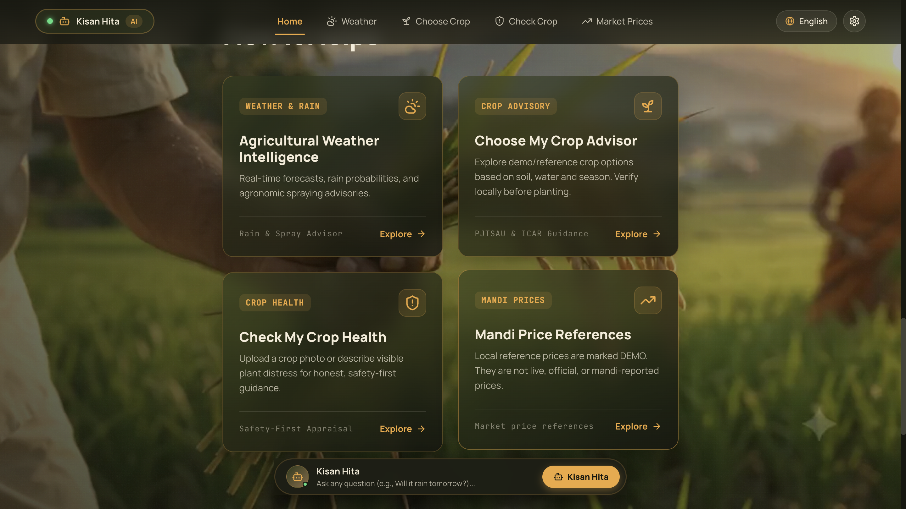
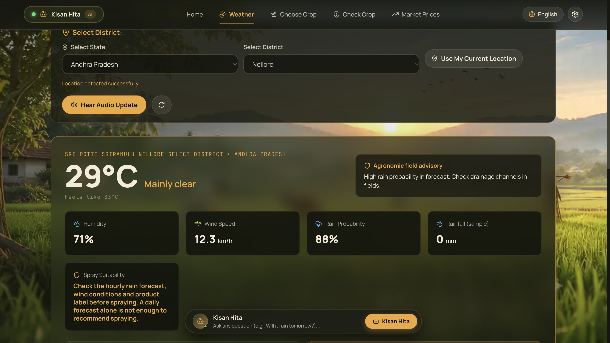
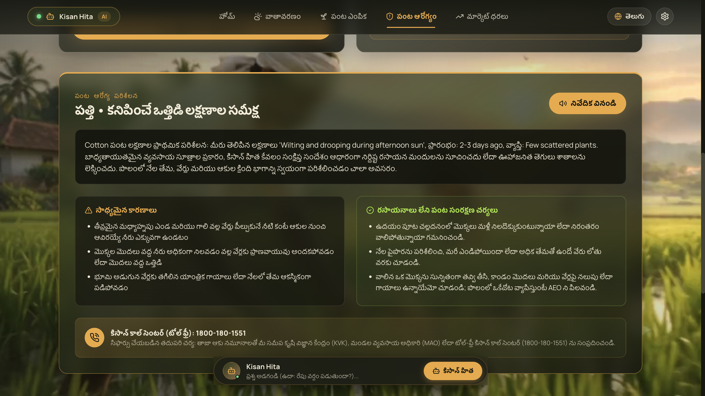
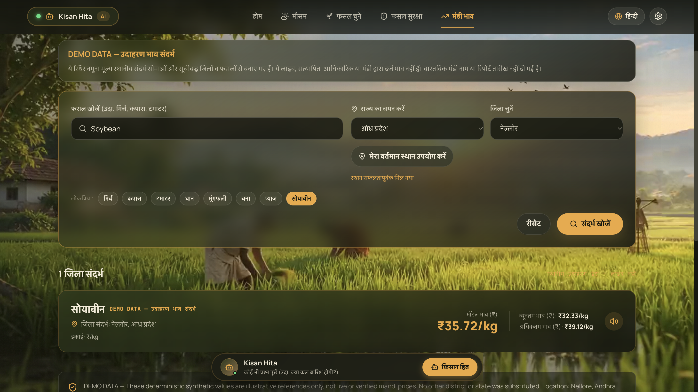

<h1 align="center">KISAN HITA</h1>

<p align="center">
  <strong>A little guidance. A better growing season.</strong><br />
  Multilingual agricultural support for farmers in seven Indian languages.
</p>

<p align="center">Built for the <strong>Great Indian AI Internship Challenge by Gnani AI</strong>.</p>

Kisan Hita is a multilingual agricultural companion designed specifically for Indian farmers. Farmers can choose their preferred language and explore agricultural information through the application's assistant and farming tools.

## Application Preview

### Home — Welcome to Kisan Hita
<p align="center"></p>
<p align="center"><em>The homepage introduces Kisan Hita and its farmer-focused experience.</em></p>

### Home — Farming Features
<p align="center"></p>
<p align="center"><em>A view of the farming tools available in the application.</em></p>

### Weather — Agricultural Weather Intelligence
<p align="center"></p>
<p align="center"><em>Weather information and farmer-oriented guidance for a selected location.</em></p>

### Check My Crop — Crop Health
<p align="center"></p>
<p align="center"><em>The crop health screen for sharing crop details and reviewing guidance.</em></p>

### Market Prices — District and Commodity Search
<p align="center"></p>
<p align="center"><em>Market price information presented for the selected location and commodity.</em></p>

### Kisan Assistant — Ask a Farming Question
<p align="center"></p>
<p align="center"><em>The assistant interface for asking farming questions.</em></p>

---

## 🌾 Reference Inspection & Design Fidelity

The application follows the visual direction of the supplied reference materials. The two original HTML references are retained in `reference/`; extracted frames and videos are not required to run the app:
- **Reference HTML (`reference/Kisan Hita.html`)**: Design tokens (`--olive: #2f3a1c`, `--cream: #f4ecd8`, `--amber: #f0a83a`, `--char: #16170f`, `--earth: #8a6a45`), font hierarchy (`Manrope` display and body, `JetBrains Mono` for badges and metrics), mesh background, scrim overlay, card padding, and button dimensions.
- **Reference screenshots and design notes**: Application screenshots are available in `docs/screenshots/`. The intended workflows include:
  1. First-visit 7-language selector modal.
  2. Hero section: *"Voice-first Agricultural Intelligence — A little guidance. A better growing season."*
  3. Persistent Central Kisan Assistant entry point across every page.
  4. Module 1: Agricultural Weather Intelligence with irrigation and spraying advisories.
  5. Module 2: Choose My Crop Advisor workflow; reference recommendations are labeled as demo guidance rather than verified agronomic advice.
  6. Module 3: Check My Crop Health with safety-first plant stress appraisal.
  7. Module 4: Market Prices search interface; sample records are explicitly labeled DEMO and are not live official prices.
  8. Module 5: Ask Kisan Hita conversational Q&A.

### 🛡️ Safety & Integrity Corrections (Critical Non-Negotiables)
- **Honest Crop Health Diagnosis**: The reference video showed an uploaded photo receiving a simulated specific disease diagnosis (*"Magnesium Deficiency / Early Blight"*) and an unverified chemical spray recommendation (*"Foliar spray of Magnesium Sulphate 1%"*). **Corrected**: Automated computer vision cannot responsibly prescribe synthetic chemicals to smallholder farmers based on a mobile photo alone. Kisan Hita accepts photographs and symptom descriptions, provides cautious non-chemical cultural management guidance (drainage, aeration, sanitation), explicitly warns against premature pesticide application, and connects the farmer to the local Krishi Vigyan Kendra (KVK) and Agricultural Extension Officer (AEO).
- **Market prices**: A deterministic local dataset provides DEMO district-level price references in INR/kg for the listed districts and commodities. These synthetic values have no real mandi identities or reporting dates and are not live, official, verified, or AGMARKNET prices.
- **Crop recommendations**: Available recommendations are labeled DEMO/reference guidance, not scientifically verified guarantees; no yield promises are made.
- **Gnani status**: Prisma v3.0 and Timbre v3.0 provider adapters are present. Voice input is a deliberate foreground MediaRecorder recording uploaded to `/api/voice/stt/upload`; continuous wake listening is not part of the active frontend. Live Gnani connectivity has not been verified. Master, Prisma, and Timbre switches default to off.

---

## 🌐 Supported Languages (All 7 Localized)

1. **తెలుగు (Telugu)** — Default agricultural pilot language
2. **English**
3. **हिन्दी (Hindi)**
4. **தமிழ் (Tamil)**
5. **ಕನ್ನಡ (Kannada)**
6. **മലയാളം (Malayalam)**
7. **मराठी (Marathi)**

The interface and farming workflows support Telugu, English, Hindi, Tamil, Kannada, Malayalam, and Marathi. Timbre v3.0 is configurable with Vasudha per language; live provider activation remains controlled by three independent backend switches.

---

## 🏛️ System Architecture

```text
kiss/
├── backend/
│   ├── app/
│   │   ├── config.py
│   │   ├── database.py
│   │   ├── main.py
│   │   ├── models/schemas.py
│   │   ├── routers/               # auth, assistant, weather, crops, market, voice, settings
│   │   └── services/              # intent, Gemini, Prisma/Timbre, weather, market, crop services
│   ├── data/                      # local illustrative market datasets
│   ├── tests/
│   ├── requirements.txt
│   └── run_tests.py               # uses a disposable SQLite test database
├── frontend/
│   ├── src/
│   │   ├── App.tsx
│   │   ├── components/
│   │   ├── context/
│   │   ├── data/indiaAdminLgd.json
│   │   ├── i18n/
│   │   ├── pages/
│   │   ├── services/              # assistant, session, MediaRecorder, TTS, geography
│   │   └── tests/
│   ├── public/assets/
│   ├── package.json
│   └── vite.config.ts
├── docs/screenshots/              # application preview screenshots
├── reference/                     # two original HTML references
├── .env.example
├── requirements.txt
├── start.sh
└── README.md
```

---

## 🚀 Quick Start Instructions

### Prerequisites
- Python 3.10+ (tested on Python 3.13.6)
- Node.js 18+ (tested on Node v24.6.0)

### 1. Single-Command Launch
```bash
./start.sh
```
This automatically boots:
- **Backend API**: `http://localhost:8000` (Swagger docs at `/docs`)
- **Frontend App**: `http://localhost:5173`

### 2. Manual Launch (Alternative)
**Backend:**
```bash
DATABASE_PATH="$PWD/kisan_hita.db" GNANI_LIVE_ENABLED=false python3 -m uvicorn backend.app.main:app --host 0.0.0.0 --port 8000
```

**Frontend:**
```bash
cd frontend
npm run dev
```

The backend loads `.env` from the project root. Relative `DATABASE_PATH` values are resolved from the process working directory, so use an explicit path when starting outside the project root. The existing project-root database (`$PWD/kisan_hita.db`) and backend-directory database (`$PWD/backend/kisan_hita.db`) are kept separate; the current listener runs from `backend/` and uses the latter. To select it from project root, set `DATABASE_PATH="$PWD/backend/kisan_hita.db"` explicitly. No automatic migration or merge is performed. For deployment, configure `DATABASE_PATH` to durable storage, `ALLOWED_ORIGINS` to the deployed frontend origin(s), and `COOKIE_SECURE=true` behind HTTPS. Gemini is optional; configure `GEMINI_API_KEY` server-side only if live Gemini features are intended. The frontend uses same-origin `/api` requests, so production hosting must reverse-proxy `/api` to FastAPI; the Vite proxy is development-only.

---

## Tests and production build

Backend tests use a temporary SQLite database and disable live Gemini/Gnani calls:

```bash
python3 backend/run_tests.py
```

Frontend tests and production build:

```bash
cd frontend
node --experimental-strip-types --test src/tests/*.test.mjs
npm run build
```

These commands run the current checked-in suites; results can vary with code changes and installed runtime versions.

---

## 🎙️ Current Voice Providers and Gnani Readiness

- **Voice input**: The assistant uses an explicit foreground `MediaRecorder` recording and multipart upload to `POST /api/voice/stt/upload`; it does not use continuous wake listening. The endpoint validates supported audio formats and duration before provider processing.
- **Prisma STT**: The backend adapter is implemented for the Prisma v3.0 REST contract. Activation requires `GNANI_LIVE_ENABLED=true`, `GNANI_PRISMA_ENABLED=true`, and a backend-only `GNANI_API_KEY`. These switches are false by default in `.env.example`; live provider connectivity has not been verified here.
- **Timbre TTS**: The backend adapter is implemented for Timbre v3.0. Configure a language-specific `GNANI_TIMBRE_VOICE_*` value (Vasudha is configured in the example for all seven app languages). Activation requires the master and Timbre switches plus the backend-only key. When disabled, the application retains its existing speech output fallback; this does not indicate Timbre audio was generated.
- **Gemini**: The reasoning provider is configured by `GEMINI_ENABLED`, `GEMINI_API_KEY`, and `GEMINI_MODEL` (default model in code: `gemini-3.1-flash-lite`). Keep the key only in the backend environment. When Gemini is unavailable, the service reports/follows its implemented fallback behavior; no live connectivity is claimed.
- **Production configuration**: set `COOKIE_SECURE=true` behind HTTPS, provide an explicit `ALLOWED_ORIGINS` list for the deployed frontend, and set `DATABASE_PATH` to durable storage. Do not use wildcard CORS with credentialed sessions. The frontend uses same-origin `/api` paths: production hosting must reverse-proxy `/api` to FastAPI (the Vite proxy is development-only). The Docker image expects a persistent `/data` mount; a Procfile deployment must separately configure durable database storage.

Official API contracts were reviewed at [Gnani STT REST documentation](https://docs.gnani.ai/api/STT/speech-to-text) and [Gnani TTS REST documentation](https://docs.gnani.ai/api/TTS/tts-inference). Real integration is blocked until a valid server-side credential is configured and the adapter is exercised against the documented response formats.


## Current API routes

The FastAPI application exposes these primary routes (interactive OpenAPI documentation is available at `/docs` when the backend is running):

| Feature | Route |
| --- | --- |
| Health / readiness | `GET /api/health`, `GET /api/ready` |
| Signup, login, session, guest entry, logout | `/api/auth/*` |
| Assistant conversation | `POST /api/assistant/chat` |
| Weather lookup | `GET /api/weather/current`, `POST /api/weather/current`, `POST /api/weather/current/coordinates` |
| Crop recommendations | `POST /api/crop-advisor/recommend` |
| Crop health check | `POST /api/crop-health/diagnose` |
| Market search | `GET /api/market-prices/search`, `POST /api/market-prices/search` |
| Voice recording transcription and speech output | `POST /api/voice/stt/upload`, `POST /api/voice/tts`; `GET /api/voice/config` |

Protected features require a valid account or guest session cookie as enforced by the backend.

## Data and provider configuration

- Weather always uses WeatherAPI.com live data and never falls back to synthetic weather. Set backend-only `WEATHERAPI_KEY` for both location and coordinate requests. The state/city selectors are a demand-discovered catalogue, not a complete WeatherAPI directory: a location is listed only after an exact WeatherAPI Search result and a successful Forecast response. Catalogue entries are cached in memory per backend process for up to seven days (maximum 500 entries); search results are cached for six hours. The catalogue starts empty after a process restart and grows as successful location searches are made. Search API coverage is not claimed to be complete. A missing key or provider failure is returned as an unavailable error. `DEMO_DATA_ENABLED` applies only to other explicitly demo-backed features, such as market-price references.
- Market prices use the included deterministic illustrative dataset. Results must be treated as demo references, not live AGMARKNET observations.
- Gemini settings are `GEMINI_ENABLED`, `GEMINI_API_KEY`, and `GEMINI_MODEL`; current default model is `gemini-3.1-flash-lite`.
- Gnani settings are `GNANI_LIVE_ENABLED`, `GNANI_PRISMA_ENABLED`, `GNANI_TIMBRE_ENABLED`, `GNANI_API_KEY`, `GNANI_PRISMA_MODEL`, `GNANI_TIMBRE_MODEL`, and `GNANI_TIMBRE_VOICE_EN`, `_TE`, `_HI`, `_TA`, `_KN`, `_ML`, `_MR`. The two modality switches cannot override the master switch. All three enable switches default to false. Credentials stay in the backend environment.
- The example selects `prisma-v3.0`, `timbre-v3.0`, and Vasudha for the seven language voice variables. This configuration alone is not evidence of successful live connectivity.
- The complete variable template is [`.env.example`](.env.example). Copy it to `.env` locally and set only the values required for the providers you intend to use. Never put server credentials in frontend variables.

## Setup and checks

From the project root, install backend dependencies and start FastAPI:

```bash
python3 -m venv .venv
source .venv/bin/activate
pip install -r requirements.txt
GNANI_LIVE_ENABLED=false python3 -m uvicorn backend.app.main:app --host 0.0.0.0 --port 8000
```

In another terminal, install frontend dependencies and run Vite:

```bash
cd frontend
npm ci
npm run dev -- --host 0.0.0.0
```

Run backend tests against the disposable database configured by the test runner:

```bash
cd ..
python3 backend/run_tests.py
```

Run frontend tests and production build:

```bash
cd frontend
node --experimental-strip-types --test src/tests/*.test.mjs
npm run build
```

The frontend Vite `/api` proxy is development-only. Production hosting must route same-origin `/api` requests to the FastAPI backend and provide durable storage for the configured SQLite database path.
